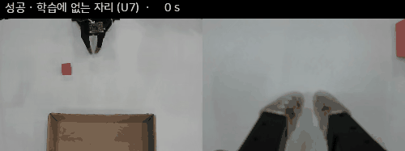
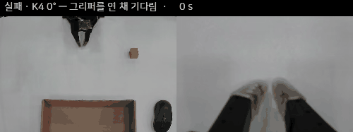
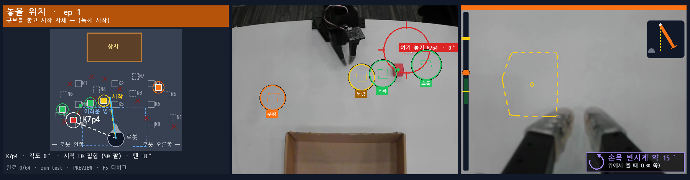
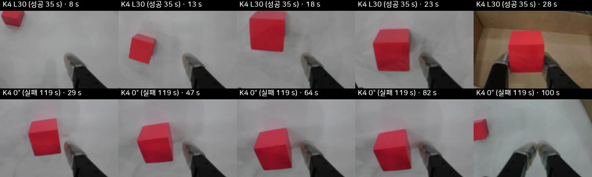

# SO-101 로봇팔 · π₀.₅ — 학습하지 않은 자리의 큐브 집기

**시연을 어떻게 찍어야 로봇이 안 배운 자리에서도 큐브를 집을까?** SO-101 로봇팔과 π₀.₅ 로 이 질문을 따라간 진행 중인 기록이다.

[연구 질문](#1-연구-질문) · [구성](#2-구성) · [방법](#3-방법--시연을-어떻게-찍었나) · [결과](#4-결과) · [실패 분석](#5-실패-분석--k4-자리의-큐브-각도) · [틀렸던 것](#6-여기까지-오면서-틀렸던-것) · [한계](#7-한계와-다음-단계) · [자료](#8-자료)

| 성공 — 학습에 없는 자리 | 실패 — 큐브 위에서 그리퍼를 연 채 기다림 |
|---|---|
|  |  |

두 영상 모두 같은 모델 (`π₀.₅-clean96`) 의 실물 실행을 빠르게 돌린 것이다 (왼쪽 칸 = 앞 카메라, 오른쪽 칸 = 손목 카메라). 실물 영상에서 추출했다 — [추출 기록](docs/figures/project_page/EXTRACTED.csv).

> **지금까지 (2026-11-13)** — 방해물 없는 시연 96 편으로 학습한 모델이 실물에서 **8 판 중 6 판** 성공했고, 그 가운데 학습에 없는 자리 4 판은 모두 성공했다. 큐브를 돌려 놓아도 8 판 중 6 판이다. 판 수가 적어 성공률이라고 부르기는 이르다. 다음 단계는 방해물이 있는 시연과 실행 중 사람 교정 (HIL) 이다.

## 1. 연구 질문
로봇팔 모방학습에서 흔한 실패는 "배운 자리에서는 되는데 조금만 옮기면 안 된다" 이다. 이 프로젝트의 과제는 단순하다 — 빨간 2.5 cm 큐브를 집어 갈색 상자에 넣는다. 질문은 하나다.

**큐브가 탁자 위 어디에, 어떤 각도로 놓여 있어도 집으려면 시연 데이터를 어떻게 설계해야 하는가?**

최종 목표는 세 단계다.

| 단계 | 내용 | 상태 |
|---|---|---|
| 1 | 방해물 없는 시연 (`clean96`) 으로 학습하고 실물 평가 | 완료 — [4 절](#4-결과) |
| 2 | 색 큐브 방해물이 있는 시연 (`distractor64`) 추가 | 계획 64 편 · 연습 3 편 |
| 3 | 실행 중 사람 교정 (HIL) 으로 남은 실패 줄이기 | 도구만 준비 |

## 2. 구성
| 항목 | 내용 |
|---|---|
| 로봇 | SO-101 follower (6 관절), 시연은 SO-101 leader 로 원격 조작 |
| 카메라 | 앞 카메라 (탁자 전체) + 손목 카메라 (그리퍼), 640×480 · 30 fps |
| 정책 | π₀.₅ (`lerobot/pi05_base` 에서 시작, action expert 만 학습), LeRobot |
| 학습 | 20,000 스텝 · batch 32 · KISTI 국가슈퍼컴퓨터 6 호기 '한강' H200 1 장 |
| 추론 | Jetson Thor 에서 실시간 (RTC, 5 denoise 스텝) |
| 과제 문장 | `pick up the red cube and put it in the brown box` |

## 3. 방법 — 시연을 어떻게 찍었나
이전 단계에서 본 실패는 대부분 **집기 직전** 에 났다. 정책은 큐브 근처까지는 가는데, 큐브가 손목 카메라 화면 가장자리에 걸리면 더 고치지 못하고 멈추거나 헛집었다 ([6 절](#6-여기까지-오면서-틀렸던-것)). 그래서 시연의 원칙을 하나로 잡았다.

**"손목 카메라에 보이는 것이 정답이 되게 한다."** 사람이 접근하는 내내 큐브를 손목 화면의 정해진 자리에 두고, 그 자리에 왔을 때만 닫는다.

시연 순서는 매 판 같다: 큐브 쪽으로 몸통 돌리기 → 그리퍼 열기 → 큐브를 손목 화면 기준 자리에 두고 다가가기 → 손목을 돌려 큐브와 나란히 → 내려가기 → 닫기 → 상자에 넣기 → 쉬는 자세.

이를 위해 수집 화면을 만들었다. 왼쪽은 위에서 본 탁자 (이번 판에 큐브를 놓을 자리), 가운데는 앞 카메라, 오른쪽은 손목 카메라와 기준 프레임이다.

*수집 화면 (시험용으로 저장 영상에 그린 그림). 오른쪽 아래 배지는 이번 판에 손목을 어느 쪽으로 돌리면 되는지 알려 준다.*

### 데이터셋 `clean96`
| 부분 | 편 | 큐브 자리 | 큐브 각도 |
|---|---:|---|---|
| 격자 | 32 | 표시해 둔 8 자리 (K1–K8) | 자리마다 0° · 왼쪽 30° · 오른쪽 30° · 45° |
| 영역 무작위 | 64 | 8 자리 둘레 영역마다 8 곳 | 네 각도 16 편씩 |

- 서로 다른 자리 72 곳, 96 편 (약 55 분). 녹화는 101 편이고, 닫는 순간 큐브가 기준 자리에서 벗어난 5 편은 빼고 같은 조건으로 다시 찍었다.
- 닫기 시작 순간 큐브의 손목 화면 위치는 기준 대비 좌우 −0.003 ± 0.016, 세로 +0.002 ± 0.019 (화면 폭 · 높이 대비) 였다.

## 4. 결과
모든 판정은 사람이 눌렀다 (큐브가 상자에 들어가면 성공). 하루 (2026-11-13), 체크포인트 하나, 조건마다 6–8 판이다.

| 조건 | 시간 제한 | 성공 |
|---|---|---|
| 학습한 자리 4 + 학습에 없는 자리 4, 큐브 0° | 60 초 | **8 판 중 6** (학습에 없는 자리 4/4, 학습한 자리 2/4) |
| 같은 8 자리, 큐브 45° · 왼쪽 30° · 오른쪽 30° | 120 초 | **8 판 중 6** (60 초 안에는 4) |
| K4 자리만, 왼쪽 30° 와 0° 번갈아 | 120 초 | 6 판 중 5 (왼쪽 30° 3/3, 0° 2/3) |

읽는 법과 주의:
- 학습에 없는 자리 4 판이 모두 성공한 것이 이 단계에서 가장 눈에 띄는 결과다. 다만 4 판이다.
- 같은 8 자리 시험에서 이전 모델들은 8 판 중 2 판 (`pilot40` 으로 추가 학습), 8 판 중 3 판 (`pilot40` 으로 새로 학습) 이었다. 데이터 · 편수 · 학습 길이가 모두 달라서 무엇 덕분인지는 가를 수 없고, 6 대 3 은 우연으로도 나올 수 있는 차이다 (Fisher p ≈ 0.31).
- 세 번째 줄은 일부러 어려운 조건만 반복한 시험이라 일반 성공률이 아니다 ([5 절](#5-실패-분석--k4-자리의-큐브-각도)).
- 22 판 전체 영상 (성공 17 · 실패 5) 을 Hugging Face 에 올렸다 ([8 절](#8-자료)).

관찰된 실패는 세 가지다: 큐브 위에서 그리퍼를 연 채 기다리다 시간 초과 · 집었다가 상자 앞에서 놓치고 다시 집기를 반복 · 쉬는 자세에서 출발하지 않음 (22 판 중 1 판, 원인 미확인).

## 5. 실패 분석 — K4 자리의 큐브 각도
K4 는 로봇 왼쪽 자리다. 여기에 큐브를 0° 로 놓으면 정책이 큐브 위까지 잘 가서, 그리퍼를 연 채 한참 기다렸다. 처음에는 좌우로 1 cm 쯤 어긋난 것이 원인이라고 봤는데 틀렸다 ([6 절](#6-여기까지-오면서-틀렸던-것)). 같은 자리에서 **큐브 각도만 바꿔** 보니 갈렸다.

*K4 자리, 손목 카메라. 위 = 큐브를 왼쪽 30° 로 놓은 판 (35 초에 성공). 아래 = 0° 로 놓은 판 (큐브가 비스듬히 보이는 채 기다리다 119 초에 실패).*

| K4 에서 | 판 | 큐브 위에서 기다린 시간 | 닫기 직전 큐브–그리퍼 각도 차 |
|---|---:|---|---|
| 왼쪽 30° | 4 | 10–22 초 | 1–4° |
| 0° | 6 | 29–70 초 | 8–11° |

(11-13 의 K4 판 전체. 두 묶음의 기다린 시간은 겹치지 않는다.)

왜 그런가. K4 에서는 몸통이 약 45° 돌아가 있어서, 0° 로 놓은 큐브가 그리퍼에게는 45° 틀어져 보인다. 정사각형이라 어느 쪽으로 돌려도 맞는 각도다. 학습 시연 96 편을 전부 조사해 보니:

- 보통의 경우 (틀어진 각 10–35°) 사람은 51 편 중 49 편에서 가까운 쪽으로 손목을 돌렸다.
- 애매한 경우 (35° 이상, 20 편) 에는 **12 편은 한쪽, 8 편은 반대쪽** 으로 돌렸다.
- 닫는 순간에는 96 편 모두 각도 차가 8° 아래였다.

기다리는 동안 정책이 낸 손목 회전 명령은 거의 0 이었다 (약 10° 가 남았는데 계획 끝에서 +0.4 ~ +0.8°).

**해석 (가설)**: 정책은 "각도가 맞아야 닫는다" 를 시연대로 배웠다. 그런데 애매한 각도에서는 시연의 방향이 갈려 있어서 마지막 회전을 끝내지 못하고, 닫는 조건이 채워지지 않아 기다린다. 큰 회전 자체가 어렵다거나 그 팔 자세의 시연이 드물다는 설명도 아직 배제하지 못했다. 한 자리 (K4) 에서만 확인했다.

이 발견으로 수집 화면에 손목 회전 권장 배지를 넣었다 ([3 절](#3-방법--시연을-어떻게-찍었나) 그림).

## 6. 여기까지 오면서 틀렸던 것
- **시연을 많이 찍으면 된다고 봤다.** 격자 자리 중심으로 384 편, 카메라를 옮겨 256 편을 찍었지만, 배운 자리에서 2 cm 만 벗어나도 성공이 크게 줄었다. 실패는 집기 직전의 정렬에서 났다.
- **집기 직전에 한쪽으로 치우치는 것이 앞 단계 가중치 탓이라고 의심했다.** 같은 40 편을 기반 모델에서 새로 학습해 다시 재 보니 치우침은 그대로였다 (+0.85 cm 대 +0.96 cm). 가중치가 아니라 데이터 쪽 문제였다.
- **정책이 접근 중에 손목 카메라를 거의 안 쓴다고 판단했다.** 손목 영상의 큐브만 옮겨 넣어 보니 맞는 방향으로 반응했다. 반응이 사라지는 것은 큐브가 화면 가장자리에 걸렸을 때였다 → 3 절의 수집 원칙이 여기서 나왔다.
- **K4 에서 못 닫는 것이 좌우 오차 때문이고, 교정 명령이 실행되지 않아서라고 봤다.** 추론 설정을 바꿔 계획을 더 길게 실행하게 하니 좌우 오차는 사라졌는데 (+0.097 → 0.003) 여전히 기다렸고, 4 판 중 1 판만 성공했다. 원인은 5 절의 큐브 각도였다.
- **도구 사고.** 평가 세션이 그리퍼를 연 채 끝나자 다음 세션이 열린 채 시작해 정책이 엉뚱하게 움직였다. 세션 끝에서도 그리퍼를 닫고, 열린 채 끝났으면 다음 시작을 막도록 고쳤다.

## 7. 한계와 다음 단계
**아직 모르는 것**
- 판 수가 적다 (조건마다 6–8 판, 하루, 체크포인트 하나, seed 하나).
- 로봇 · 카메라 배치 · 탁자 · 큐브 · 상자가 하나씩이다. 방해물은 학습에 없다.
- 5 절의 각도 설명은 K4 한 자리에서만 확인했고, 방향을 통일해 다시 학습해 보지는 않았다.
- 출발하지 않는 실패의 원인.

**다음**
1. 방해물 데이터 `distractor64` 수집 (연습 3 편은 깨끗하게 찍혔다 — 가까운 방해물이 손목 화면에 같이 들어와도 사람 시연의 정렬은 그대로였다).
2. `clean96` + `distractor64` 로 학습해 방해물이 있는 실물 평가.
3. 남은 실패 상태 (각도가 조금 남은 채 기다림, 놓친 뒤 다시 집기) 에서 사람이 넘겨받아 마무리하는 HIL 수집.

## 8. 자료
| 종류 | 이름 | 내용 |
|---|---|---|
| 🤗 데이터셋 | `ahnjaeyeong/so101-cube-spatial-clean96` | 시연 101 편 (학습 96 편), 편별 표 포함 |
| 🤗 모델 | `ahnjaeyeong/pi05-so101-cube-spatial-clean96` | `π₀.₅-clean96`, 20,000 스텝 |
| 🤗 실물 영상 | `ahnjaeyeong/so101-cube-spatial-eval-rollouts` | 평가 22 판 (성공 · 실패 모두), 판별 표 포함 |
| 기록 | [연구 기록 안내](docs/00_연구_기록_안내.md) · [실험 목차](EXPERIMENT_INDEX.md) | 실험 21 개의 설정 · 수치 · 원본 사본 |

Hugging Face 저장소는 올리는 중이며 확인 뒤 공개로 바꾼다.

### 이름 대응표
이 페이지는 읽기 쉬운 이름을 쓴다. 기록 문서와 원본 폴더는 실험 때 쓴 내부 이름을 그대로 쓴다.

| 이 페이지 | 기록 문서의 이름 | 뜻 | 기록 |
|---|---|---|---|
| `clean96` | sg_pin | 방해물 없는 시연 96 편 | [EXP-19](experiments/19_clean96_sgp01/README.md) |
| `π₀.₅-clean96` | sgp01 020000 | clean96 으로 학습한 모델 | [EXP-19](experiments/19_clean96_sgp01/README.md) |
| `distractor64` | sg_pin_dis | 방해물이 있는 시연 64 편 (계획) | [EXP-21](experiments/21_k4_angle_rotation/README.md) |
| `pilot40` | sg50_pilot3 | 앞 단계 시연 40 편 | [EXP-15](experiments/15_sg50_sgft01/README.md) |
| `pilot40` 추가 학습 모델 | sgft01 | 256 편 모델에서 이어서 학습 | [EXP-16](experiments/16_sgft01_real_eval/README.md) |
| `pilot40` 새로 학습 모델 | sgb01 | 기반 모델에서 새로 학습 | [EXP-18](experiments/18_sgb01_base_control/README.md) |
| 추론 설정 시험 | — | 계획을 더 길게 실행 | [EXP-20](experiments/20_inference_setting_test/README.md) |
| K4 각도 대조 · 시연 전수조사 | — | 5 절 | [EXP-21](experiments/21_k4_angle_rotation/README.md) |
| 384 편 · 256 편 | redbox_all · d2 | 6 절의 앞 단계 데이터 | [EXP-03](experiments/03_redbox_384_20k/README.md) · [EXP-06](experiments/06_d2_256/README.md) |

수치의 출처와 조건은 각 기록 문서에 있다. 기록 문서는 모든 문장에 사실 · 관찰 · 가설을 구분해 적는다.
