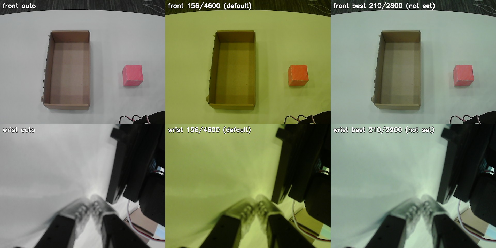

# 카메라 설정 (front · wrist)

## 결정
- **수집과 테스트 모두 자동 노출·자동 화이트밸런스**를 쓴다.
  - `auto_exposure=3` (Aperture Priority), `white_balance_automatic=1`
  - `exposure_dynamic_framerate=0` — 자동 노출이 30fps 아래로 프레임레이트를 낮추지 못하게 한다.
- 메모: 16:21에 수동으로 바꾼 값이 16:23에 USB 재연결 기록 없이 기본값(자동)으로 돌아간 일이 있었음. 원인 미상.
- 카메라 설정은 장치에 저장되지 않는다. USB를 다시 꽂거나 재부팅하면 다시 맞춘다 (아래 명령).

```bash
for d in /dev/cam_front /dev/cam_wrist; do
  v4l2-ctl -d $d -c auto_exposure=3 -c white_balance_automatic=1 -c exposure_dynamic_framerate=0
done
```

## 측정
- 날짜·시각: **2026-10-02 16:18–16:21 (KST)**, Jetson Thor, 카메라 Innomaker-U20CAM-720P ×2, 640x480 MJPG 30fps
- 조명 조건:
  - 블라인드:
  - 실내등:
  - 기타:
- 방법: 흰 탁자 영역(ROI)의 R·G·B 평균. 무채색 정도 = R·G·B 표준편차 / 평균. 밝기 = Y(0.299R+0.587G+0.114B).
  자동 화면은 5초 스트리밍한 뒤 찍었다. 밝기·대비·채도·색조·gain·gamma는 기본값 그대로이고, 바꾸지 않았다.
- 비교 이미지: [camera_settings/cam_wb_compare.jpg](camera_settings/cam_wb_compare.jpg)
  — 왼쪽부터 자동 / 156·4600 / 수동 후보값, 위 front · 아래 wrist



| 카메라 | 설정 | R | G | B | 밝기 Y | 색 치우침 |
|---|---|---|---|---|---|---|
| front | 자동 | 163 | 165 | 164 | 164 | 0.4% |
| front | 156 / 4600 (기본값) | 148 | 158 | 78 | 146 | 27.6% |
| front | 210 / 2800 (후보) | 153 | 171 | 158 | 164 | 4.8% |
| wrist | 자동 | 172 | 172 | 172 | 172 | 0.1% |
| wrist | 156 / 4600 (기본값) | 151 | 166 | 90 | 153 | 24.3% |
| wrist | 210 / 2900 (후보) | 158 | 181 | 164 | 172 | 6.0% |

## 156 / 4600은 쓰지 않는다 (인계서 값 정정)
- `exposure_time_absolute=156`, `white_balance_temperature=4600`은 **두 카메라의 기본값**이다 (`v4l2-ctl -l`의 default, 아래 참고).
  인계서에 기준값으로 적힌 값은 실제로 맞춘 값이 아니라 기본값이었다.
- 이 값으로 수동 고정하면 B가 크게 모자라서 화면이 **노랗고 초록빛**으로 뜬다 (위 표: B 78~90, G가 가장 높음).

## 수동 후보값 (적용 안 함)
| 카메라 | exposure_time_absolute | white_balance_temperature | 비고 |
|---|---|---|---|
| front | 210 | **2800** | 화이트밸런스 범위(2800–6500)의 **끝값(최솟값)** |
| wrist | 210 | **2900** | 끝값 바로 옆 (2800–2900에서 차이 거의 없음) |

- 화이트밸런스: 이 카메라는 값을 낮출수록 파란색이 늘어난다. 가장 무채색에 가까운 값이 범위 맨 끝에 있어서 더 내릴 수 없다.
- **이 값에서도 남는 색끼: 옅은 청록·초록빛.** G가 R보다 front 12%, wrist 15% 높고, B보다 8~10% 높다.
  노란기는 빠지지만 초록빛은 화이트밸런스 온도만으로는 없앨 수 없다.
- 노출 210: 흰 탁자 밝기가 자동 화면과 1 이내로 같고, 하얗게 날아간 영역은 0%다. 1/30초(333) 이하라서 30fps가 유지된다(측정 30.6fps).
- **수동 값은 위 측정 때의 조명에서만 유효하다.** 블라인드나 실내등이 바뀌면 다시 측정해야 한다.

### 자동에 문제가 생겼을 때 수동 후보값으로 돌아가는 명령
```bash
# 모드를 먼저 수동으로 바꾸고, 그다음 값을 넣는다 (자동 상태에서는 값이 적용되지 않는다)
v4l2-ctl -d /dev/cam_front -c auto_exposure=1 -c white_balance_automatic=0
v4l2-ctl -d /dev/cam_front -c exposure_time_absolute=210 -c white_balance_temperature=2800
v4l2-ctl -d /dev/cam_wrist -c auto_exposure=1 -c white_balance_automatic=0
v4l2-ctl -d /dev/cam_wrist -c exposure_time_absolute=210 -c white_balance_temperature=2900
# 확인
for d in /dev/cam_front /dev/cam_wrist; do v4l2-ctl -d $d -C auto_exposure,exposure_time_absolute,white_balance_automatic,white_balance_temperature; done
```

## v4l2-ctl -l 전체 출력
기록 시점(2026-10-02 16:23)의 출력이다. `default=`가 카메라 기본값이고, `value=`는 기록 시점 상태(자동 노출·자동 WB, dynamic=0 — 기본값과 같음)다.

```
=== /dev/cam_front

User Controls

                     brightness 0x00980900 (int)    : min=-64 max=64 step=1 default=0 value=0
                       contrast 0x00980901 (int)    : min=0 max=64 step=1 default=32 value=32
                     saturation 0x00980902 (int)    : min=0 max=128 step=1 default=64 value=64
                            hue 0x00980903 (int)    : min=-40 max=40 step=1 default=0 value=0
        white_balance_automatic 0x0098090c (bool)   : default=1 value=1
                          gamma 0x00980910 (int)    : min=72 max=500 step=1 default=100 value=100
                           gain 0x00980913 (int)    : min=0 max=100 step=1 default=0 value=0
           power_line_frequency 0x00980918 (menu)   : min=0 max=2 default=1 value=1 (50 Hz)
      white_balance_temperature 0x0098091a (int)    : min=2800 max=6500 step=1 default=4600 value=4600 flags=inactive
                      sharpness 0x0098091b (int)    : min=0 max=6 step=1 default=3 value=3
         backlight_compensation 0x0098091c (int)    : min=0 max=192 step=1 default=80 value=80

Camera Controls

                  auto_exposure 0x009a0901 (menu)   : min=0 max=3 default=3 value=3 (Aperture Priority Mode)
         exposure_time_absolute 0x009a0902 (int)    : min=1 max=5000 step=1 default=156 value=156 flags=inactive
     exposure_dynamic_framerate 0x009a0903 (bool)   : default=0 value=0
=== /dev/cam_wrist

User Controls

                     brightness 0x00980900 (int)    : min=-64 max=64 step=1 default=0 value=0
                       contrast 0x00980901 (int)    : min=0 max=64 step=1 default=32 value=32
                     saturation 0x00980902 (int)    : min=0 max=128 step=1 default=64 value=64
                            hue 0x00980903 (int)    : min=-40 max=40 step=1 default=0 value=0
        white_balance_automatic 0x0098090c (bool)   : default=1 value=1
                          gamma 0x00980910 (int)    : min=72 max=500 step=1 default=100 value=100
                           gain 0x00980913 (int)    : min=0 max=100 step=1 default=0 value=0
           power_line_frequency 0x00980918 (menu)   : min=0 max=2 default=1 value=1 (50 Hz)
      white_balance_temperature 0x0098091a (int)    : min=2800 max=6500 step=1 default=4600 value=4600 flags=inactive
                      sharpness 0x0098091b (int)    : min=0 max=6 step=1 default=3 value=3
         backlight_compensation 0x0098091c (int)    : min=0 max=192 step=1 default=80 value=80

Camera Controls

                  auto_exposure 0x009a0901 (menu)   : min=0 max=3 default=3 value=3 (Aperture Priority Mode)
         exposure_time_absolute 0x009a0902 (int)    : min=1 max=5000 step=1 default=156 value=156 flags=inactive
     exposure_dynamic_framerate 0x009a0903 (bool)   : default=0 value=0
```
