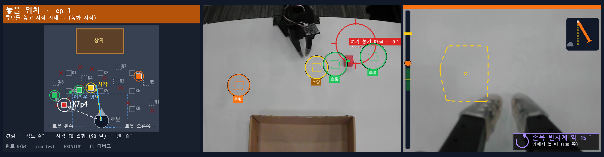

# EXP-21 · K4 각도 대조 6 판 · 시연 96 편 손목 회전 방향 전수조사 · 손목 회전 권장 UI · 방해물 연습 3 판

| 항목 | 내용 |
|---|---|
| 실험 ID | **EXP-21** (EXP-19 sgp01 020000 의 K4 0° 머묾 원인) |
| 날짜 | 2026-11-13 (대조 14:18 – 14:33) |
| 상태 | `COMPLETED` (대조 6 판 · 전수조사 · UI) / 방해물 본 수집 64 편은 `PLANNED` |
| 표기 | [사실] 파일 측정값 · [관찰] 연구자 실물 관찰 · [가설] 분석 해석 · [계획] 설계만 |

## 목적
EXP-19 · EXP-20 에서 K4 0° 는 좌우가 맞아도 그리퍼를 연 채 오래 머물렀다. 사용자 가설 "큐브 회전각이 핀포인트와 안 맞아서 잡을지 말지 고민한다" 를 같은 자리에서 큐브 각도만 바꿔 시험하고, 학습 시연에서 손목을 어느 쪽으로 돌렸는지 전수조사한다.

## 검증 가설
- [가설] K4 에서 큐브를 그리퍼 기준 정면에 가깝게 (L30) 놓으면 0° 보다 닫기 전에 머무는 시간이 짧다.
- 사전 판정 기준 (결과 전에 정함): L30 3 판도 30 s 씩 머물면 각도 가설 기각.

## 데이터셋 · 모델
학습 없음. 모델 = sgp01 020000 ([EXP-19](../19_clean96_sgp01/README.md)), 추론 설정 = EXP-19 와 같음 (기본).

## 평가 방법
- 실물 6 판: K4 L30 · K4 0° 번갈아 3 판씩 (시행 21–26), 판 최대 120 s, 사람 판정. run `20261113_141855…`.
- 놓인 각도 (front 검출): L30 판 +28° · +26° · +33°, 0° 판 +1° · −3° · 0°.
- 머문 시간 · 각도 차: 손목 화면에서 닫기 자리 ref 대비 (5 Hz). 시행 24 · 26 은 자동 검출이 잡은 시각을 잘못 짚어 프레임 표에서 읽음.

## 평가 결과 [사실 · 사람 판정]
| 시행 | 각도 | 판정 | 길이 s | 가까이서 머문 시간 s | 닫기 직전 각도 차 |
|---:|---|---|---:|---:|---|
| 21 | L30 | P | 34.7 | 10.0 | +1° |
| 22 | 0° | F | 118.9 | 69.8 | +11° |
| 23 | L30 | P | 41.2 | 13.0 | −4° |
| 24 | 0° | P | 97.8 | 약 60 (프레임 표) | 약 10° (프레임 표) |
| 25 | L30 | P | 53.9 | 22.2 | +2° |
| 26 | 0° | P | 93.1 | 약 55 (프레임 표) | 약 10° (프레임 표) |
- L30 3/3 (35–54 s), 0° 2/3 (93–119 s). 60 s 기준으로는 L30 3/3 · 0° 0/3.
- [사실] 11-13 의 K4 판 전체 (EXP-19 · 20 포함): 0° 6 판 머묾 29–70 s, L30 4 판 10–22 s — 겹치지 않음.
- [사실] 11-13 의 17 판 (가까이 간 판): 닫기 직전 각도 차 ≥ 8° 인 판의 머문 시간 중앙 31 s, < 8° 는 10 s (Mann–Whitney p ≈ 0.02, Spearman 0.49 p ≈ 0.04). 8° 기준은 결과를 본 뒤 정함.

### 머무는 동안의 정책 계획 [사실 · 실물 run 에 저장된 계획]
K4 0° 3 판, 그리퍼를 열고 멈춘 구간 (계획 77–110 개씩):
- wrist_roll 명령 (계획 끝 − 지금): 중앙 +0.4 ~ +0.8° (10–90% −0.7 ~ +2.6°), 실행 구간 끝에서는 0.0 ~ +0.1°.
- 닫기가 들어 있는 계획 비율 7 · 23 · 8% (L30 판 10–30%). wrist_roll 은 서보 전 범위, 멈춘 값 100–132.

## 시연 96 편 손목 회전 방향 전수조사 [사실 · in-sample]
- 정의: 상대 각 = wrap±45°(큐브 각도 + 닫을 때 pan), L30 = +30. 손목 회전량 = 닫기 시작 순간 wrist_roll − 시작 값.
- 회전량 ≈ 0.86 × 상대 각 − 6.4 (|상대 각| < 35 인 76 편, 상관 0.78).
- 쪽 (닫을 때 pan < −15 / > +15) × 방향 (8° 넘게 돌린 쪽):

| 쪽 | + | − | 거의 안 돌림 |
|---|---:|---:|---:|
| 로봇 왼쪽 (39 편) | 12 | 18 | 9 |
| 정면 (18 편) | 8 | 8 | 2 |
| 로봇 오른쪽 (39 편) | 16 | 18 | 5 |

- |상대 각| 10–35°: 돌린 51 편 중 49 편이 가까운 쪽 (반대 = ep 45 · 64).
- |상대 각| ≥ 35° (20 편): + 12 · − 8 (왼쪽 4/4 · 정면 4/1 · 오른쪽 4/3). 같은 조건에서 반대인 예: K8 R30 ep 29 (−42°) · ep 80 (+40°).
- 닫는 순간 각도 차 ≥ 8° 인 편 0 (최대 7.8°). K4 0° 는 상대 각 ≈ ±45°.

## 분석 결과
- [사실] K4 에서 큐브 각도만 바꾸면 머무는 시간이 갈린다. 0° 판에서는 약 10° 가 남은 채 손목 회전 명령이 거의 0 이다.
- [가설] 상대 각이 ±45° 에 가까우면 어느 쪽으로 돌려도 되고, 시연이 두 방향으로 갈려 있어 정책이 마지막 회전을 끝내지 못한다. (경쟁: 큰 회전 자체가 어렵다 · K4 의 팔 자세가 드물다 — 이 자료로는 가르지 못함.)
- [가설] EXP-19 의 '좌우 오차 때문에 못 닫는다' 는 틀렸다 (EXP-20 에서 좌우가 맞아도 머묾).

## 손목 회전 권장 UI (수집 도구)
- 사용자 결정: 전체를 한 방향으로 고정하지 않는다. 판마다 권장 방향을 화면에 띄우고 애매한 각은 그때 정한다.
- `sg_plan.turn_advice`: 계획의 필요 회전각을 시연 기준 (0.86 × 값 − 5.1) 으로 보정 → < 10° '거의 그대로' · 10–35° 가까운 쪽 (반시계 / 시계) · 계획 값 ≥ 35° '어느 쪽이든'. 손목 칸 오른쪽 아래 배지 (`sg_viewer.draw_turn_hint`), 그룹 설정 `turn_hint`.
- 위에서 본 탁자 그림에 방해물 자리 (색 네모) 표시 추가.
- [사실] 시험 `tests/test_sg_turn.py` 5/5: 권장 방향이 있는 시연 49 편 중 47 편이 같은 방향.
- 화면 예 (시험이 저장 영상으로 그린 그림): `../11_r1_r2_recovery/sources/r1_r2_collection/screenshots/sg_turn/`

## 방해물 조건 (2 단계) — 계획 · 연습 3 판
- [계획] `sg_pin_dis` 64 편: 빨강 자리 = clean96 의 영역 무작위 64 곳, 각도는 그 자리의 clean 판과 다르게 (각도마다 16), 색 큐브 (노랑 · 주황 · 파랑 · 초록) 2–6 개. 계획표 `sources/sg_pin_dis/`. 권장 분포: 거의 그대로 17 · 반시계 10 · 시계 23 · 애매 14.
- [사실] 연습 3 판 (`sources/sg_pin_dis_pilot/`): 모두 저장. 닫는 순간 du +0.011 ~ +0.027 · dv −0.026 ~ +0.033 · 크기 0.96 – 1.00 · 각도 차 ≤ 2°. 가까운 방해물 (5.4 cm) 은 닫는 순간에도 손목 화면에 보이고, 먼 것 (약 10 cm) 은 접근 중에만 지나감. 손목 검출이 방해물을 빨강으로 잡은 프레임 0 / 355.
- [사실] 보정 전 배지는 실제 회전과 10–17° 어긋남 (ep0 권장 반시계 10° · 실제 +1°, ep2 권장 그대로 · 실제 −24°) → 위 보정 추가.

## 한계 및 미확인
- 대조는 K4 한 자리 3 + 3 판. 다른 자리에서의 재현 미확인.
- 방향 갈림이 원인인지는 재학습으로 확인하지 않음.

## 다음 실험으로 이어진 이유
- [계획] 방해물 64 편 수집 (권장 배지 사용) → clean96 + distractor64 학습 → HIL.
- [계획] |상대 각| ≥ 35° 의 − 방향 8 편 · 먼 길 2 편을 뺀 86 편 재학습으로 방향 갈림 가설 확인 (미결정).

## 원본 자료
- 복사본: `sources/sg_pin_dis/` · `sources/sg_pin_dis_pilot/` · 실물 run = [`../19_clean96_sgp01/sources/sgp01_real_eval/eval/rollouts/20261113_141855…`](../19_clean96_sgp01/sources/sgp01_real_eval/)
- 원본 경로: `/home/user/so101_runs/main_k8/sgp01_real_eval` · `/home/user/so101_runs/main_k8/sg_pin_dis` · `/home/user/so101_runs/practice/sg_pin_dis_pilot`
- 전수조사 · 머묾 측정 스크립트는 세션 임시 폴더에서 돌림 (프로젝트에 저장 안 함) — 방법은 위 정의와 같음.
